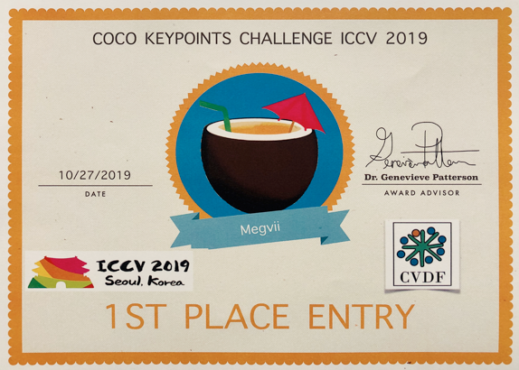
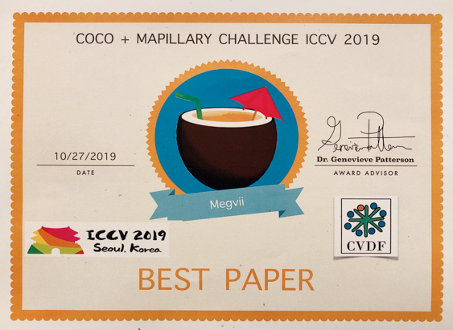
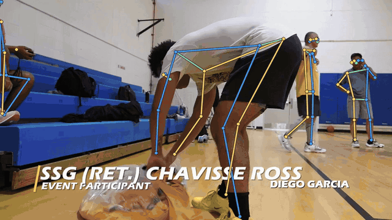
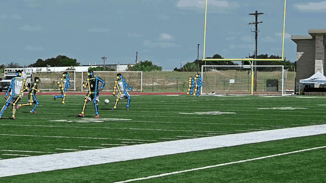
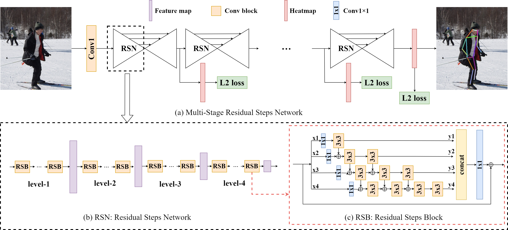
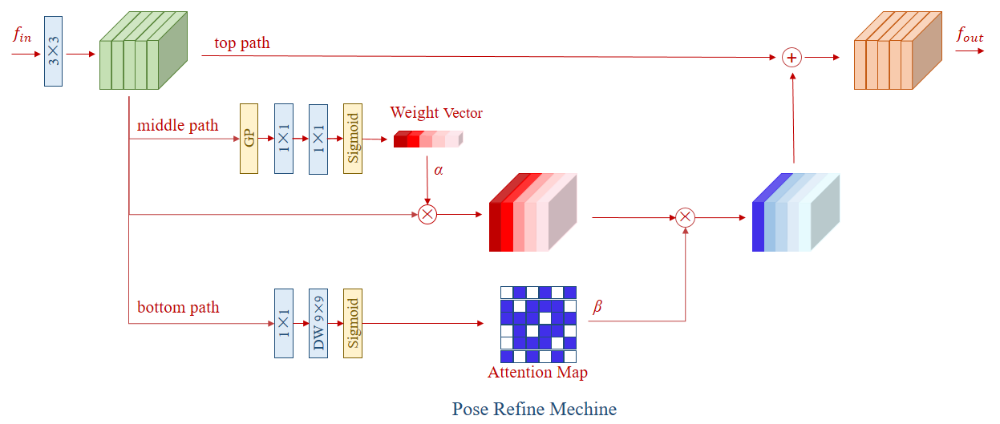

# Learning Delicate Local Representations for Multi-Person Pose Estimation (ECCV 2020 Spotlight)

[](https://huggingface.co/CaiYuanhao/RSN)
[](https://huggingface.co/spaces/CaiYuanhao/RSN)
[](https://caiyuanhao1998.github.io/RSN-Project/)

[](https://arxiv.org/abs/2003.04030)
[](https://cocodataset.org/#keypoints-leaderboard)
[](https://github.com/caiyuanhao1998/RSN/blob/master/figures/2019_best_paper.png)
[](https://zhuanlan.zhihu.com/p/112297707)

*This is a pytorch realization of [Residual Steps Network][11] **which won 2019 COCO Keypoint Challenge and ranks 1st place on both COCO test-dev and test-challenge datasets as shown in [COCO leaderboard][1]**.

<div align="center">
<p align="center">   </p>
</div>

## Models

| Model | Training data | Directory |
| --- | --- | --- |
| Res-18 | COCO | [Res18.coco](Res18.coco/) |
| RSN-18 | COCO | [RSN18.coco](RSN18.coco/) |
| RSN-18 | MPII | [RSN18.mpii](RSN18.mpii/) |
| 4×RSN-18 | COCO | [4XRSN18.coco](4XRSN18.coco/) |
| RSN + RTMPose-X | COCO + MPII | [RTMPose-X](RTMPose-X/) |

RSN + RTMPose-X reaches **79.124422 AP** on COCO val2017 with H56 proposals and flip inference, up **0.306 AP points** over the reproduced RTMPose-X. The video pipeline uses YOLOX-S with the released checkpoint.

| Basketball | Volleyball | Soccer |
| :---: | :---: | :---: |
|  |  |  |

[Inference and benchmarks](RTMPose-X) · [MP4 downloads and footage credits](RTMPose-X/MEDIA.md)

#### News

- **2026.11.20** · We released **RSN + RTMPose-X** with 79.124422 AP on COCO val2017, training code for COCO and MPII, and an online demo with side-by-side input and pose predictions for both images and videos. [Weights](https://huggingface.co/CaiYuanhao/RSN) · [Training](RTMPose-X/TRAINING.md) · [Demo](https://huggingface.co/spaces/CaiYuanhao/RSN) · [Project page](https://caiyuanhao1998.github.io/RSN-Project/)
- **2026.11.20** · We upgraded the demo to Gradio 6.16.0 for the reported dependency fixes. Rendered videos now use the app's managed cache so they can be cleaned up automatically. [Dependabot update](https://github.com/caiyuanhao1998/RSN/pull/38)
- **2026.11.20** · MPII evaluation now prints plain numeric PCKh scores with NumPy 2. [Runtime fixes](LOCAL_SETUP.md#fixes)
- **2026.11.17** · We updated the PyTorch and CUDA dependencies, restricted checkpoint loading to weights, and fixed distributed training, checkpoint resume, and COCO and MPII evaluation edge cases. [Runtime fixes](LOCAL_SETUP.md#fixes) · [Dependency update](https://github.com/caiyuanhao1998/RSN/pull/37)
- **2020.09 :** Our RSN has been integrated into the great [MMPose](https://github.com/open-mmlab/mmpose) framework. Thanks to their effort. Welcome to use their [codebase](https://github.com/open-mmlab/mmpose) with their [pre-trained model zoo](https://mmpose.readthedocs.io/en/latest/model_zoo_papers/backbones.html#rsn-eccv-2020). ⭐
- **2020.07 :** Our paper has been accepted as Spotlight by ECCV 2020 :rocket: 
- **2019.09 :** Our work won the **First place** and **Best Paper Award** in COCO 2019 Keypoint Challenge :trophy: 


<hr />

> **Abstract:** *In this paper, we propose a novel method called Residual Steps Network (RSN). RSN aggregates features with the same spatialsize (Intra-level features) efficiently to obtain delicate local representations, which retain rich low-level spatial information and result in precise keypoint localization. In addition, we propose an efficient attention mechanism - Pose Refine Machine (PRM) to further refine the keypoint locations. Our approach won the 1st place of COCO Keypoint Challenge 2019 and achieves state-of-the-art results on both COCO and MPII benchmarks, without using extra training data and pretrained model. Our single model achieves 78.6 on COCO test-dev, 93.0 on MPII test dataset. Ensembled models achieve 79.2 on COCO test-dev, 77.1 on COCO test-challenge dataset.*
<hr />

## Pipieline of Residual Steps Network


## Architecture of Pose Refine Machine



## Some prediction resullts of our method on COCO and MPII valid datasets


## Results(Original Version)

### Results on COCO val dataset
| Model | Input Size | GFLOPs | AP | AP<sup>50</sup> | AP<sup>75</sup> | AP<sup>M</sup> | AP<sup>L</sup> | AR | 
| :-----------------: | :-----------: | :--------: | :------: |:------: | :------: | :------: | :------: | :------: |
| Res-18 | 256x192 | 2.3 | 70.7 | 89.5 | 77.5 | 66.8 | 75.9 | 75.8 | 92.8 | 83.2 | 72.7 | 82.1 |
| RSN-18 | 256x192 | 2.5 | 73.6 | 90.5 | 80.9 | 67.8 | 79.1 | 78.8 | 93.7 | 85.2 | 74.7 | 84.5 |
| RSN-50 | 256x192 | 6.4 | 74.7 | 91.4 | 81.5 | 71.0 | 80.2 | 80.0 | 94.4 | 86.2 | 76.0 | 85.7 |
| RSN-101 | 256x192 | 11.5 | 75.8 | 92.4 | 83.0 | 72.1 | 81.2 | 81.1 | 95.6 | 87.6 | 77.2 | 86.5 |
| 2×RSN-50 | 256x192 | 13.9 | 77.2 | 92.3 | 84.0 | 73.8 | 82.5 | 82.2 | 95.1 | 88.0 | 78.4 | 87.5 |
| 3×RSN-50 | 256x192 | 20.7 | 78.2 | 92.3 | 85.1 | 74.7 | 83.7 | 83.1 | 95.9 | 89.1 | 79.3 | 88.5 |
| 4×RSN-50 | 256x192 | 29.3 | 79.0 | 92.5 | 85.7 | 75.2 | 84.5 | 83.7 | 95.5 | 89.4 | 79.8 | 89.0 |
| 4×RSN-50 | 384x288 | 65.9 | 79.6 | 92.5 | 85.8 | 75.5 | 85.2 | 84.2 | 95.6 | 89.8 | 80.4 | 89.5 |


### Results on COCO test-dev dataset
| Model | Input Size | GFLOPs | AP | AP<sup>50</sup> | AP<sup>75</sup> | AP<sup>M</sup> | AP<sup>L</sup> | AR |
| :-----------------: | :-----------: | :--------: | :------: | :------: | :------: | :------: | :------: | :------: |
| RSN-18 | 256x192 | 2.5 | 71.6 | 92.6 | 80.3 | 68.8 | 75.8 | 77.7 |
| RSN-50 | 256x192 | 6.4 | 72.5 | 93.0 | 81.3 | 69.9 | 76.5 | 78.8 |
| 2×RSN-50 | 256x192 | 13.9 |  75.5 | 93.6 | 84.0 | 73.0 | 79.6 | 81.3 |
| 4×RSN-50 | 256x192 | 29.3 | 78.0 | 94.2 | 86.5 | 75.3 | 82.2 | 83.4 |
| 4×RSN-50 | 384x288 | 65.9 | 78.6 | 94.3 | 86.6 | 75.5 | 83.3 | 83.8 |
| 4×RSN-50<sup>\+</sup> | - | - | 79.2 | 94.4 | 87.1 | 76.1 | 83.8 | 84.1 |

### Results on COCO test-challenge dataset
| Model | Input Size | GFLOPs | AP | AP<sup>50</sup> | AP<sup>75</sup> | AP<sup>M</sup> | AP<sup>L</sup> | AR |
| :-----------------: | :-----------: | :--------: | :------: | :------: | :------: | :------: | :------: | :------: |
| 4×RSN-50<sup>\+</sup> | - | - | 77.1 | 93.3 | 83.6 | 72.2 | 83.6 | 82.6 |

### Results on MPII dataset
| Model | Split | Input Size | Head | Shoulder | Elbow | Wrist | Hip | Knee | Ankle | Mean |
| :-----------------: | :------------------: | :-----------: | :------: | :------: | :------: | :------: | :------: | :------: | :------: | :------: |
| 4×RSN-50 | val | 256x256 | 96.7 | 96.7 | 92.3 | 88.2 | 90.3 | 89.0 | 85.3 | 91.6 |
| 4×RSN-50 | test | 256x256 | 98.5 | 97.3 | 93.9 | 89.9 | 92.0 | 90.6 | 86.8 | 93.0 |


## Results(Pytorch Version)
### Results on COCO val dataset
 Model | Input Size | GFLOPs | AP | AP<sup>50</sup> | AP<sup>75</sup> | AP<sup>M</sup> | AP<sup>L</sup> | AR | 
| :-----------------: | :-----------: | :--------: | :------: |:------: | :------: | :------: | :------: | :------: |
| Res-18 | 256x192 | 2.3 | 65.2 | 87.3 | 71.5 | 61.2 | 72.2 | 71.3 | 91.4 | 77.0 | 68.7 | 79.5 |
| RSN-18 | 256x192 | 2.5 | 70.4 | 88.8 | 77.7 | 67.2 | 76.7 | 76.5 | 93.0 | 82.8 | 72.2 | 82.5 |


#### Note
* \+ means using ensemble models.
* All models are trained on 8 V100 GPUs
* We done all the experiments using our orginal DL-Platform, all results in our paper are reported on this DL-Platform. There are some differences between it and Pytorch.

## Repo Structure

```text
RSN/
├── 4XRSN18.coco/
├── RSN18.coco/
├── RSN18.mpii/
├── RTMPose-X/
├── Res18.coco/
├── cvpack/
├── dataset/
├── lib/
└── model_logs/
```

## Quick Start

### Installation

For the verified local Python/CUDA environment, dataset locations, runtime fixes, and reproducible smoke checks, see [LOCAL_SETUP.md](LOCAL_SETUP.md).

From the repository root in a Python 3.11 environment, install the dependencies and set the project import path. Choose the wheel index for your platform. [PyTorch installation](https://pytorch.org/)

```bash
python -m pip install torch==2.13.0 torchvision==0.28.0 --index-url https://download.pytorch.org/whl/cu126
python -m pip install -r requirements.txt
export RSN_HOME="$PWD"
export PYTHONPATH="$RSN_HOME${PYTHONPATH:+:$PYTHONPATH}"
```

### Dataset

#### COCO

1. Download images from [COCO website][4], and put train2014/val2014 splits into **$RSN_HOME/dataset/COCO/images/** respectively.

2. Download ground truth from [Google Drive][6] or [Baidu Drive][10] (code: fc51), and put it into **$RSN_HOME/dataset/COCO/gt_json/**.

3. Download detection result from [Google Drive][6] or [Baidu Drive][10] (code: fc51), and put it into **$RSN_HOME/dataset/COCO/det_json/**.

#### MPII

1. Download images from [MPII website][5], and put images into **$RSN_HOME/dataset/MPII/images/**.

2. Download ground truth from [Google Drive][6] or [Baidu Drive][10] (code: fc51), and put it into **$RSN_HOME/dataset/MPII/gt_json/**.

3. Download detection result from [Google Drive][6] or [Baidu Drive][10] (code: fc51), and put it into **$RSN_HOME/dataset/MPII/det_json/**.


### Train

Run the selected experiment from the repository root. For RSN-18 on COCO with eight GPUs, run

```bash
torchrun --standalone --nproc-per-node=8 RSN18.coco/train.py
```

For RSN + RTMPose-X, follow the [training command](RTMPose-X/TRAINING.md).

### Test

Set the GPU count, model folder and saved iteration for your run.

```bash
torchrun --standalone --nproc-per-node=8 RSN18.coco/test.py -i 96000
```

## Citation
Please considering citing our projects in your publications if they help your research.
```
@inproceedings{cai2020learning,
  title={Learning Delicate Local Representations for Multi-Person Pose Estimation},
  author={Yuanhao Cai and Zhicheng Wang and Zhengxiong Luo and Binyi Yin and Angang Du and Haoqian Wang and Xinyu Zhou and Erjin Zhou and Xiangyu Zhang and Jian Sun},
  booktitle={ECCV},
  year={2020}
}

@inproceedings{cai2019res,
  title={Res-steps-net for multi-person pose estimation},
  author={Cai, Yuanhao and Wang, Zhicheng and Yin, Binyi and Yin, Ruihao and Du, Angang and Luo, Zhengxiong and Li, Zeming and Zhou, Xinyu and Yu, Gang and Zhou, Erjin and others},
  booktitle={Joint COCO and Mapillary Workshop at ICCV},
  year={2019}
}
```


[1]: http://cocodataset.org/#keypoints-leaderboard
[4]: http://cocodataset.org/#download
[5]: http://human-pose.mpi-inf.mpg.de/
[6]: https://drive.google.com/open?id=14zW0YZ0A9kPMNt_wjBpQZg5xBiW5ecPd
[10]: https://pan.baidu.com/s/1MqpmR7EkZu3G_Hi0_4NFTA
[11]: https://arxiv.org/abs/2003.04030
