<h1 align="center">Learning Delicate Local Representations for Multi-Person Pose Estimation</h1>

<p align="center"><b>RSN · ECCV 2020 Spotlight</b></p>

<p align="center">
  <a href="https://arxiv.org/abs/2003.04030"></a>
  <a href="https://caiyuanhao1998.github.io/RSN-Project/"></a>
  <a href="https://huggingface.co/CaiYuanhao/RSN"></a>
  <a href="https://huggingface.co/spaces/CaiYuanhao/RSN"></a><br>
  <a href="https://caiyuanhao1998.github.io/RSN-Project/coco-leaderboard-2019.html"></a>
  <a href="figures/2019_best_paper.png"></a>
  <a href="https://zhuanlan.zhihu.com/p/112297707"></a>
</p>

Residual Steps Network (RSN) aggregates features at the same spatial resolution to localize human keypoints. The Pose Refine Machine (PRM) further refines those predictions.

<p align="center">
  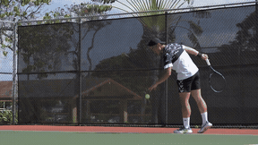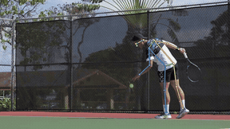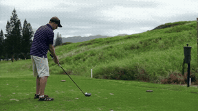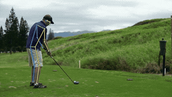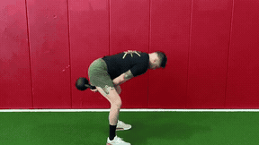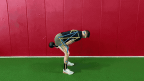<br>
  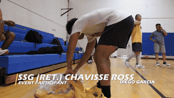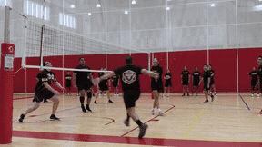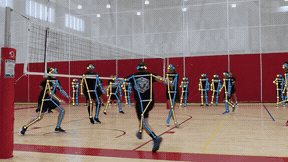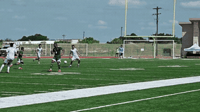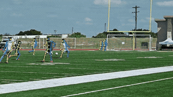<br>
  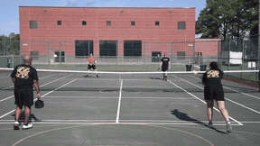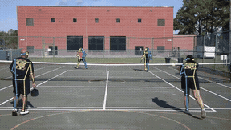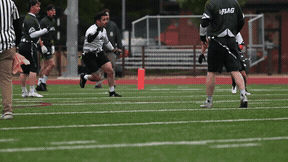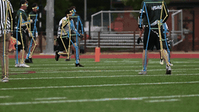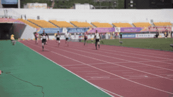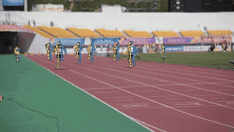
</p>

<p align="center"><sub>Each pair shows the original footage on the left and the RSN pose overlay on the right.</sub></p>

### News

- **2026.11.20** · We released **RSN + RTMPose-X** with **79.13 AP** on COCO val2017.
- **2026.11.20** · Our online demo is live. Give it a try 🤗 [Online Demo](https://huggingface.co/spaces/CaiYuanhao/RSN)
- **2026.11.20** · Fixed MPII PCKh reporting with NumPy 2.
- **2026.11.17** · Updated PyTorch and CUDA dependencies and fixed distributed training, checkpoint resumption, and evaluation.
- **2020.09** · RSN joined the [MMPose model zoo](https://mmpose.readthedocs.io/en/latest/model_zoo_papers/backbones.html#rsn-eccv-2020).
- **2020.07** · RSN was accepted as an ECCV 2020 Spotlight.
- **2019.09** · RSN won first place and the Best Paper Award in the COCO 2019 Keypoint Challenge.

## 1. Create Environment

Use Python 3.11 and the CUDA 12.6 PyTorch build for training and evaluation. Run the commands below from the repository root after cloning.

```bash
git clone https://github.com/caiyuanhao1998/RSN.git
cd RSN
conda create -n rsn python=3.11 -y
conda activate rsn
python -m pip install --extra-index-url https://download.pytorch.org/whl/cu126 -r RTMPose-X/requirements-lock.txt
export RSN_HOME="$PWD"
export PYTHONPATH="$RSN_HOME${PYTHONPATH:+:$PYTHONPATH}"
```

For CPU inference or a local demo, use a separate environment.

```bash
conda create -n rsn-cpu python=3.11 -y
conda activate rsn-cpu
python -m pip install -r RTMPose-X/requirements-demo.txt
```

## 2. Prepare Dataset

Download the images for your experiment from [COCO](https://cocodataset.org/#download) and [MPII](http://human-pose.mpi-inf.mpg.de/). Get the original RSN annotations and detections from [Google Drive](https://drive.google.com/open?id=14zW0YZ0A9kPMNt_wjBpQZg5xBiW5ecPd) or [Baidu Drive](https://pan.baidu.com/s/1MqpmR7EkZu3G_Hi0_4NFTA) (code `fc51`).

| Experiment | Images | Annotations and detections |
| --- | --- | --- |
| Original COCO models | `dataset/COCO/images/{train2014,val2014}/` | `dataset/COCO/gt_json/train_val_minus_minival_2014.json`, `dataset/COCO/gt_json/minival_2014.json`, `dataset/COCO/det_json/minival_2014_det.json` |
| RSN-18 on MPII | `dataset/MPII/images/` | `dataset/MPII/gt_json/{train.json,valid.json,valid.mat}` and `dataset/MPII/det_json/test.json` |
| RSN + RTMPose-X | `dataset/COCO/images/{train2017,val2017}/` and `dataset/MPII/images/` | `dataset/COCO/annotations_trainval2017.zip`, `dataset/COCO/det_json/COCO_val2017_detections_AP_H_56_person.json` and `dataset/MPII/gt_json/train.json` |

The RTMPose-X variant can reuse the COCO 2014 images by matching COCO image IDs. Keep the official 2017 annotations ZIP intact for training. The H56 detections are available from the [MMPose dataset guide](https://github.com/open-mmlab/mmpose/blob/main/docs/en/dataset_zoo/2d_body_keypoint.md#coco).

## 3. Testing

### Evaluation

For the original experiments, set `-i` to the iteration in your `model_logs/<user>/<experiment>/iter-<iteration>.pth` checkpoint. Use the GPU count available on your machine.

```bash
torchrun --standalone --nproc-per-node=8 Res18.coco/test.py -i 96000
torchrun --standalone --nproc-per-node=8 RSN18.coco/test.py -i 96000
torchrun --standalone --nproc-per-node=8 4XRSN18.coco/test.py -i 96000
torchrun --standalone --nproc-per-node=8 RSN18.mpii/test.py -i 28800
```

For the released RSN + RTMPose-X weights, prepare the COCO index once and run COCO val2017 evaluation. You can also set `eval_cache` to the data directory from a training run and skip the cache preparation.

```bash
eval_cache=model_logs/rsn-eval-data
mkdir -p "$eval_cache"
unzip -oq dataset/COCO/annotations_trainval2017.zip \
  'annotations/person_keypoints_*2017.json' -d "$eval_cache"
cp dataset/COCO/det_json/COCO_val2017_detections_AP_H_56_person.json "$eval_cache/"
RSN_RTMPOSE_DATA="$eval_cache" PYTHONPATH="$PWD/RTMPose-X:${PYTHONPATH:-$PWD}" \
  python -c 'from data_pipeline import prepare_records; prepare_records("dataset/COCO/images")'
```

```bash
mkdir -p checkpoints
curl -fL https://huggingface.co/CaiYuanhao/RSN/resolve/main/rsn-rtmpose-x.pth -o checkpoints/rsn-rtmpose-x.pth
RSN_RTMPOSE_DATA="$eval_cache" torchrun --standalone --nproc-per-node=8 \
  RTMPose-X/evaluate.py --checkpoint checkpoints/rsn-rtmpose-x.pth \
  --output model_logs/rtmpose-x-validation --batch-size 32 --workers 4 --amp fp16
```

Evaluation uses H56 person detections and flip inference and writes `metrics.json` under `--output`. See the [COCO and MPII paper benchmarks](https://caiyuanhao1998.github.io/RSN-Project/#paper-results).

### Inference on images and videos

The pipeline downloads the released pose checkpoint and YOLOX-S detector on first use. In the CUDA environment, add the download and video dependencies with `python -m pip install huggingface_hub==0.36.0 imageio-ffmpeg==0.6.0`. The CPU inference environment already includes them.

```bash
python RTMPose-X/pipeline.py input.jpg poses.jpg
python RTMPose-X/pipeline.py input.mp4 poses.mp4
```

Add `--device cpu` to force CPU inference. To launch the local browser demo in the demo environment, run `python RTMPose-X/app.py`.

## 4. Training

### Original RSN experiments

Choose one command. The examples use eight GPUs. Checkpoints are saved to `model_logs/<user>/<experiment>/`. Resume with `-c <checkpoint>`.

```bash
torchrun --standalone --nproc-per-node=8 Res18.coco/train.py
torchrun --standalone --nproc-per-node=8 RSN18.coco/train.py
torchrun --standalone --nproc-per-node=8 4XRSN18.coco/train.py
torchrun --standalone --nproc-per-node=8 RSN18.mpii/train.py
```

### RSN + RTMPose-X

Download the official RTMPose-X Body7 initialization checkpoint and run the trainer on COCO and MPII. Repeat the command with the same output directory to resume.

```bash
mkdir -p checkpoints
curl -fL https://download.openmmlab.com/mmpose/v1/projects/rtmposev1/rtmpose-x_simcc-body7_pt-body7_700e-384x288-71d7b7e9_20230629.pth \
  -o checkpoints/rtmpose-x-body7.pth
python RTMPose-X/train.py --checkpoint checkpoints/rtmpose-x-body7.pth \
  --coco-archive dataset/COCO/annotations_trainval2017.zip \
  --coco-images dataset/COCO/images \
  --detections dataset/COCO/det_json/COCO_val2017_detections_AP_H_56_person.json \
  --mpii-annotations dataset/MPII/gt_json/train.json --mpii-images dataset/MPII/images \
  --data-dir model_logs/rtmpose-x-data --output model_logs/RTMPose-X --gpus 8
```

## 5. Citation

If you use RSN in your research, please cite our work.

```bibtex
@inproceedings{cai2020learning,
  title     = {Learning Delicate Local Representations for Multi-Person Pose Estimation},
  author    = {Yuanhao Cai and Zhicheng Wang and Zhengxiong Luo and Binyi Yin and
               Angang Du and Haoqian Wang and Xinyu Zhou and Erjin Zhou and
               Xiangyu Zhang and Jian Sun},
  booktitle = {ECCV},
  year      = {2020}
}

@inproceedings{cai2019res,
  title     = {Res-Steps-Net for Multi-Person Pose Estimation},
  author    = {Cai, Yuanhao and Wang, Zhicheng and Yin, Binyi and Yin, Ruihao and
               Du, Angang and Luo, Zhengxiong and Li, Zeming and Zhou, Xinyu and
               Yu, Gang and Zhou, Erjin and others},
  booktitle = {Joint COCO and Mapillary Workshop at ICCV},
  year      = {2019}
}
```
